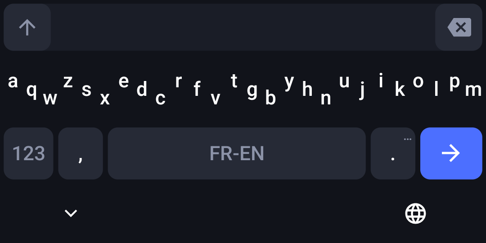

# Type1 — a one-line AZERTY/QWERTY Android keyboard

Every letter sits on **one horizontal line**, between a suggestion strip and a
row of utility keys: ~154 dp of screen instead of the usual ~250 dp. The typing
logic is written in **Rust** and shared through a tiny JNI bridge; Android draws
the three bands, applies editor actions, and supplies editor metadata plus the
system personal dictionary. That split is deliberate: an iOS port later only
needs a new UI + FFI shim.

<p align="center">
  
</p>

The middle band has **no key boxes and no groups**: 26 evenly spaced letters in
physical column order (AZERTY `A Q W`, `Z S X`, ...; QWERTY `Q A Z`, `W S X`,
...). All glyphs share one size and one case. Each letter is shifted vertically
according to its physical row — top-row letters higher, bottom-row letters
lower — so the original layout stays legible.
The row is lowercase normally and uppercase while shift (or auto-capitalisation)
is active. Taps resolve by horizontal position; you can drag along the strip and
release on the letter you want.

## Status: MVP

- AZERTY and QWERTY layouts, all 26 letters on one line in physical column
  order with row-based vertical offsets, uniform size and case (uppercase while
  shift/auto-caps is active). AZERTY is the default.
- Profiles pair a layout with one or more languages. They are created in
  **Keyboard profiles** (main settings → Keyboard profiles; *Profils de clavier*
  in French): the layout comes from a dropdown and the languages are toggles
  (Français, English (UK)). The list starts empty, and the keyboard falls back
  to `AZERTY · Français` until a profile exists.
- Settings are split into a main page and five sub-pages, each with a sticky
  title and a test field:
  - **Setup** — enable Type1 and choose it as the current keyboard.
  - **Keyboard profiles** — create, edit, select and delete profiles.
  - **Behaviour** — spacebar drag, long-press backspace and swipe sensitivity.
  - **Appearance** — space-row height.
  - **About** — dictionary credits and clickable GPL/CC BY-SA notices.

  A final **Personal dictionary** row opens Android’s system user-dictionary
  settings.
- The settings screens have English and French resources, with English as the
  default and French in `values-fr`. Android 13+ lists both in the system's
  per-app language setting.
- The settings activities are resizeable for split-screen, freeform/desktop
  windows and keyboard-driven resizing.
- Long-press `,` to open a small shortcut bubble. It offers the emoji panel,
  the settings gear, and—when at least two profiles exist—a globe that cycles
  to the next profile. The emoji panel itself has a scrollable grid with a
  category strip (recent emoji first, then smileys, people, activities, objects,
  travel, sports, symbols, signs, flags and text emoticons).
- The spacebar shows the active profile's language codes (`FR`, `FR-EN`, ...)
  instead of the word “espace”. The layout itself is visible on the keys.
- Predictive back gestures are enabled for the settings pages (Android 13+),
  including the system cross-activity animation.
- Numbers and symbols take over the letter line (`123`, `#+=`).
- Autocorrection at word boundaries from frequency-ranked dictionaries (all
  typable Lexique 3.83 French forms, full wordfreq English list),
  with a layout-aware touch model: neighbouring-key slips, transpositions,
  missing accents (`ecole` → `école`) and French elision
  (`jai` → `j'ai`, `taimx` → `t'aime`, `taipe` → `t'aime`).
- British English autocorrection (`langauge` → `language`, `recieve` →
  `receive`) with British spellings preferred (`colour`, `centre`, `organise`,
  `favourite`, `behaviour`).
- English contractions are restored (`dont` → `don't`, `cant` → `can't`,
  `isnt` → `isn't`, `youre` → `you're`, `oclock` → `o'clock`). Any ordinary
  candidate that equals a contraction key is shown as the contraction, so
  `douv` and `eont` also become `don't` the same way French elisions work.
  A strong ordinary correction still wins when clearly better
  (`therde` → `there`). Ambiguous forms such as `its`/`it's`, `well`/`we'll`
  and `ill`/`I'll` are left alone. `lets` keeps `lets` and `let's` side by
  side in the strip; it autocorrects to `let's` only at the start of a sentence,
  and stays `lets` mid-sentence unless `let's` is picked.
- Narrow-key rescue: when every typed key is one or two keys away from a
  word, the most frequent such word is offered (`geqnvx` → `beauté`,
  `vqjmd` → `t'aime`, `bknjpur` → `bonjour`). One-key candidates always rank
  first: `emps` shows `temps` before the two-key `elle`.
- One-letter spelling variants are considered even when the letter is far from
  the key pressed: `commant` offers `comment` (frequency) and `collant`
  (two-key slip), both in the strip.
- Very last resort: when nothing is one or two keys away and no spelling
  variant fits, the closest same-length dictionary word is offered
  (`bodjmur` → `bonjour`). That tier is suggestion-only, never auto-applied.
- The suggestion strip ranks by word frequency as well as key distance, so
  `ne` comes before `eu` for `ue`, and `t'aime` before the rare `tapie`.
- Short tokens fill the strip with more candidates: up to six for two or three
  letters, five for four, four for five, and three for longer words.
- Single-letter tokens get suggestions too: one-letter words and accents first,
  then the neighbouring keys, including the second ring. In French, `q` offers
  `à`, `a`, then `w` and `z`; an English neighbour of `I` offers `I` first, then
  both `i` and the other nearby letters. Single letters are suggestion-only,
  never auto-corrected.
- A word that is already a dictionary word still gets nearby alternatives in
  the strip (`falk` → `talk`, `to` → `go`); it is replaced automatically only
  when the known-word margin is exceeded.
- Android's personal dictionary is loaded while the keyboard is enabled. Exact
  entries are protected from autocorrection, close typos are offered as
  suggestions, and entries follow their language. Only single-token entries are
  used for now; whitespace/hyphen entries and personal shortcuts are ignored.
- Short words are corrected too, to the most likely candidate: `pq` → `la`
  (with `ma` offered next in the strip). Rare dictionary words are corrected
  the same way (`pa` → `la`), while common words stay put.
- Overlapping fast taps are supported: keys are sent in the order they went
  down, even when several fingers are still held (`x` then `d` → `xd`).
- The suggestion strip shows correction candidates while typing and the
  original + alternatives after a correction; the first backspace undoes the
  correction, keeps the boundary you typed and reopens the word.
- Words the keyboard changes are remembered for the current field. Move the
  caret back into one and the suggestions for the form you actually typed are
  offered again. The memory is capped at 1,000 words / 256 KB and cleared on a
  new or sensitive field.
- An accepted suggestion is not corrected again: backspacing over its automatic
  space keeps the chosen word when the next comma, space or symbol is typed.
- Move the caret back into an existing word and the strip re-suggests
  corrections for it; tapping one replaces the whole word in place
  (`Roppxjf` → `Comment`). Backspacing over a finished word's boundary brings
  its corrections back too, without moving the caret. Typing in the middle of
  a word keeps the text after the caret in the correction token, so the
  suggestions still cover the whole word.
- Conservative application: a confidence margin (stricter for two-letter
  tokens), mixed-case words are left alone, and all-caps words are corrected
  while keeping their capitals (`LANGAUGE` → `LANGUAGE`, `JAI` → `J'AI`). No
  autocorrection in email, URI, name, address or search fields (including
  plain-text fields that use the Search action), though the strip still offers
  suggestions there, even when the app sets the no-suggestions flag. Password
  fields always hide the strip; other plain-text fields honor that flag.
- French accents on long-press (`é è ê ë à â ç ù û î ï ô ö œ ÿ ñ`), plus `’`.
- Shift (tap once = one capital, twice = caps lock), auto-capitalisation from
  `inputType` (`CAP_SENTENCES`, `CAP_WORDS`, `CAP_CHARACTERS`), with sentence
  case as the default for plain text. Caps lock adds a bar under the shift
  arrow so it is distinct from one-shot shift. The caret's real position is
  re-read on start, selection changes and after backspace, so a new sentence is
  capitalised even when the space after the period was deleted.
- French spacing: space before `? ! : ;`, automatic space after `. , ; : ! ?`
  when a new word starts. A stray space before `.` or `,` is removed, including
  the convenience space added by tapping a suggestion. Applying a suggestion or
  correction never stacks a second space on an existing one. Profiles without
  French use Latin spacing instead.
- Backspace with a configurable long-press (repeat, swipe to size a selection,
  or nothing); enter adapts to the editor action (`→`, `✓`, `🔍`, `➤`).
  An explicit action wins even in multiline fields; a newline is used only when
  the editor has no action or sets `IME_FLAG_NO_ENTER_ACTION`.
- Drag along the letter line to correct a press before releasing.
- Drag horizontally on the spacebar to move the caret without leaving the
  current field; the setup screen has a switch to turn this off.
- Swipe sensitivity (8–40 dp per character) is adjustable with a slider and
  shared by the spacebar caret drag and the backspace selection.
- Spacebar row height is adjustable (36–72 dp, 48 dp by default).
- Shift and backspace sit at the ends of the suggestion strip; the bottom row is
  page, comma, space, period and enter. Long-press the period for the full
  symbol set (`& % + " - : ' @ ; / ( ) # ! ?`); a `…` hint marks the long
  alternate list. Long-press the page key for a popup with `0`–`9` and slide to
  type one digit without switching page.
- Vector icons for shift, backspace and enter (the enter icon follows the editor
  action: return, arrow, search, send, check).
- Sounds, haptics, pressed-letter highlight.

Not in the MVP: next-word prediction (context model), an in-app
personal-dictionary editor, dictionary imports, glide typing, clipboard
manager, voice input, themes, physical keyboard.

## Why one line?

26 letters on a 360 dp phone give each letter ~11 dp of width. That is far below
the 48 dp accessibility guideline, and it is the central trade-off of the
design: one line saves ~100 dp of height, and the suggestion strip is what makes
it workable. Three things compensate:

- nearest-letter hit testing (the whole strip is one target area),
- drag-to-correct: press, slide, release on the right letter,
- autocorrection with layout-aware candidates (`dkre` → `dire`,
  `ecole` → `école`).

Layout and language are data, not code: `core/src/layout.rs` lists the AZERTY
and QWERTY letters in physical column order with a `row` index (0 top, 1 home,
2 bottom), each language owns its dictionary in `core/src/language.rs`, and
`core/src/profile.rs` combines one layout with a set of languages at runtime.
The core exposes layouts and languages separately; the user's profiles are
stored in preferences, so no combination list is hard-coded.

## Sizing

The three bands are 38 dp (suggestions), 56 dp (letters) and 36–72 dp
(utilities, 48 dp by default),
plus 3 dp gaps: **154 dp** total by default. On a 411 dp-wide phone a letter is
~12.5 dp wide; on 360 dp it is ~11 dp. Tuning knobs:

- `suggestionHeight`, `letterHeight` in `KeyboardView.kt`,
- the utility row height is a setting (36–72 dp, default 48),
- the `rowOffset` values (±7 dp) in `KeyboardView.kt`,
- letter order, row indices and utility weights in `core/src/layout.rs`,
- the active languages and layout in `core/src/profile.rs`,
- `MIN_SCORE`, `TWO_KEY_MIN_SCORE`, `AGGRESSIVE_WEIGHT`, `LENGTH_PENALTY`,
  `KNOWN_WORD_MARGIN` and `TIER1_FALLBACK_MARGIN` in `core/src/correction.rs`,
- the dictionaries in `core/data/` (see `core/data/NOTICE.md`).

## Repository layout

```
core/                     Rust crate (no Android dependency)
  src/layout.rs           layouts and their letter/number/symbol pages
  src/language.rs         language definitions and dictionaries
  src/dictionary.rs       lazily loaded per-language word lists
  src/correction.rs       profile-scoped candidates and scoring
  src/profile.rs          runtime layout + language configuration
  src/personal.rs         dynamic host personal-word overlay
  src/lexicon.rs          accent folding
  src/json.rs             tiny JSON writer for the render payload
  src/engine.rs           shift, caps, spacing, word buffer, correction, undo
  src/action.rs           actions emitted to the platform (commit/delete/ime)
  src/ffi.rs              JNI surface (create/render/key/inputType/personalWords/layouts/languages/profile)
  data/fr.tsv             derived Lexique 3.83 list (all typable French forms)
  data/en.tsv             derived wordfreq list (all single-token English forms)
  data/NOTICE.md          dictionary licences and attribution
  examples/evaluate.rs    dev-only correction evaluation
  examples/make_autocorrect_cases.rs  regenerate the typo fixtures
  examples/make_all_caps_cases.rs  regenerate the caps-lock fixture
  examples/make_fuzzy_contraction_cases.rs  regenerate contraction typos
  examples/make_fuzzy_contraction_extra_cases.rs  wider contraction typos
  tests/engine_tests.rs   keyboard-engine behaviour tests
  tests/interaction_tests.rs  full editing sessions through a small editor model
  tests/english_bulk_tests.rs  contractions, caps-lock and single letters
  tests/autocorrect_tests.rs  bulk autocorrect regressions
  tests/data/autocorrect_cases.tsv  2,500 mixed typo cases
  tests/data/two_key_cases.tsv  2,000 two-key-slip cases
  tests/data/spelling_cases.tsv  2,000 spelling-variant cases
  tests/data/all_caps_cases.tsv  2,000 all-caps typo cases
  tests/data/fuzzy_contraction_cases.tsv  3,121 contraction typos
  tests/data/fuzzy_contraction_extra_cases.tsv  1,946 wider contraction typos
app/                      Android app (Kotlin, no AndroidX needed)
  src/main/java/fr/type1/keyboard/
    Type1Ime.kt           InputMethodService
    KeyboardView.kt       three bands + touch handling
    EmojiPickerPopup.kt   emoji panel opened from the comma
    EmojiData.kt          emoji categories and recent-emoji tab
    SettingsPageActivity.kt  sticky title + test-field scaffold
    SettingsActivity.kt   main settings hub
    SetupActivity.kt      setup page: enable/pick the keyboard
    ProfilesActivity.kt   create/edit/delete and select profiles
    BehaviourActivity.kt  space drag, backspace hold, swipe sensitivity
    AppearanceActivity.kt space-row height
    AboutActivity.kt      licences and dictionary credits
    core/NativeBridge.kt  external fun declarations
    core/KeyboardController.kt
    core/PersonalDictionary.kt  reads Android's user dictionary
    model/RowModel.kt     JSON model (suggestions, letters, keys)
    model/KeyAction.kt    JSON action model
    model/KeyboardProfile.kt  user profile and its JSON storage
    model/Json.kt         shared string-array parsing
  src/main/res/layout/settings_header.xml  shared sticky header
  src/main/res/raw/license_*.txt  licence notices shown on the About page
scripts/build-rust.ps1    cross-compile the core into jniLibs
scripts/build-dictionary.ps1  regenerate core/data/fr.tsv from Lexique 3.83
scripts/build-english-dictionary.py  regenerate core/data/en.tsv from wordfreq
scripts/export-wordfreq.py  export the full English wordfreq list
tools/jni-smoke/          JVM smoke test for the JNI contract (no device)
.github/workflows/release.yml  tag-triggered signed APK release
docs/AUTOCORRECT.md       correction, ranking and auto-apply specification
docs/type1-keyboard.png   keyboard screenshot used above
```

## Dictionary

`core/data/fr.tsv` is derived from [Lexique 3.83](http://www.lexique.org)
(CC BY-SA 4.0): all single-token forms the keyboard can type — lowercase
letters and inner apostrophes, with no spaces, hyphens or other punctuation —
with film and book frequencies summed per form, stored as hundredths of
`ln(freq + 1)` plus a part-of-speech flag used to validate elisions (`j'aime`
but not `t'est`). The resulting list has about 121,000 forms (1.85 MB) and
includes inflected forms. The setup screen shows the attribution and
`core/data/NOTICE.md` carries the full notice. `cargo run --release --example
evaluate` reports top-1 accuracy on synthetic typos and the random-string
false-positive rate. `scripts/build-dictionary.ps1` regenerates the list from
an extracted `Lexique383.tsv`; `-MinFreq` can apply a frequency floor and
`-Count` can cap the list.

`core/data/en.tsv` is derived from [wordfreq](https://github.com/rspeer/wordfreq)
(CC BY-SA 4.0). It keeps every single alphabetic token up to 31 characters with
a positive wordfreq probability, including names, places, brands and modern
terms such as `nike`, `covid` and `sncf`. Common American spellings are
converted to British ones (`colour`, `centre`, `organise`, `favourite`) while
words valid in both varieties (`meter`/`metre`, `program`/`programme`,
`tire`/`tyre`) are kept. The pronoun `I` is kept capitalised. The resulting list
has about 287,000 forms (3.6 MB). Scores use the same hundredths of
`ln(frequency per million + 1)` scale as French.
`scripts/export-wordfreq.py` exports the full package list (it requires the
`wordfreq` Python package) and `scripts/build-english-dictionary.py` regenerates
`en.tsv`.

The complete correction, ranking and auto-apply specification is in
[docs/AUTOCORRECT.md](docs/AUTOCORRECT.md).

The row/action contract between the two halves is JSON over JNI; input type and
personal words use primitive JNI values and string arrays.

```jsonc
// render(handle) -> the three bands
{ "page": "letters", "shift": 0, "caps": false,
  "suggestions": ["Écouter", "Écrire", "École"],
  "letters": [ { "id": "a", "label": "A", "letter": true,
                 "row": 0, "alts": ["à","â","ä"] }, ... ],
  "strip":   [ { "id": "shift", "label": "⇧", "kind": "shift", "on": false },
               { "id": "backspace", "label": "⌫", "kind": "backspace", "on": false } ],
  "keys":    [ { "id": "page", "label": "123", "kind": "page",
                 "w": 1.0, "on": false }, ... ] }

// key(handle, "a") -> actions to apply
[ { "t": "commit", "v": "A" } ]

// key(handle, "sug:0") -> replace the word being typed
[ { "t": "delete", "n": 2 }, { "t": "commit", "v": "Écouter " } ]
```

## Build

### 1. Rust core

```bash
cargo test                 # core logic, runs on the host
rustup target add aarch64-linux-android armv7-linux-androideabi x86_64-linux-android
cargo install cargo-ndk
export ANDROID_NDK_HOME=/path/to/ndk      # PowerShell: $env:ANDROID_NDK_HOME
./scripts/build-rust.ps1                  # writes app/src/main/jniLibs/<abi>/*.so
```

`./gradlew buildRust` runs the same step and is wired to `preBuild`. It only
warns when the toolchain is missing, so Kotlin errors stay readable.

### 2. APK

Requirements: **JDK 17 or 21**. JDK 24+ breaks Gradle 8.11 (its embedded Kotlin
parser rejects version strings such as `27.0.1.0.3`, which is all the error
message says). `gradle/gradle-daemon-jvm.properties` pins the daemon to a JDK 21
toolchain, so the wrapper works even when `JAVA_HOME` points elsewhere.

Open the project in Android Studio (JDK 17 or 21) or:

```bash
./gradlew assembleDebug
adb install -r app/build/outputs/apk/debug/app-debug.apk
```

If toolchain auto-detection does not find a JDK 21, run Gradle through the
helper, which searches `JAVA_HOME`, Android Studio's JBR, `~/.jdks` and
`Program Files\Java` and picks the newest 17-21:

```powershell
./scripts/gradle.ps1 assembleDebug
```

Then launch **Type1**, enable it in the system settings, and pick it with the
keyboard switcher.

### 3. Test without a device

```powershell
# core logic: 13,567 fixture rows (6,500 typos + 2,000 all-caps + 3,121
# fuzzy contractions + 1,946 wider contraction typos), ~30,000 full
# interaction sessions, 1,836 exact contraction cases, 11,309 fuzzy
# contraction executions and 1,488 single-letter checks
cd core; cargo test

# JNI contract: real JVM -> Rust -> JSON (uses the host build of the core)
./tools/jni-smoke/run.ps1
```

`core/tests/interaction_tests.rs` drives complete editing sessions through the
engine and a small editor model: typing, autocorrect, suggestion taps,
punctuation spacing, undo, backspace, recorrections, page switches, digits and
selection deletion. The cases are generated deterministically, so a failure
prints the exact key sequence and the expected/actual text.

The bulk fixtures are regenerated after tuning the corrector:

```powershell
cd core; cargo run --release --example make_autocorrect_cases
cd core; cargo run --release --example make_all_caps_cases
cd core; cargo run --release --example make_fuzzy_contraction_cases
cd core; cargo run --release --example make_fuzzy_contraction_extra_cases
```

`run.ps1` prints the row model and the actions for a few key presses. The Java
class mirrors the Kotlin `NativeBridge` so a broken symbol name or signature
fails immediately, without installing an APK.

## Releases

Pushing a tag that starts with `v` runs `.github/workflows/release.yml`, which
tests the core, builds a signed release APK, and publishes it with a SHA-256
checksum:

```bash
git tag v1.0.0
git push origin v1.0.0
```

The tag becomes the Android `versionName` (without the leading `v`), while the
`versionCode` is the GitHub Actions run number. Tags containing a hyphen, such
as `v1.1.0-beta.1`, are published as prereleases.

### Signing secrets

Add these repository secrets under **Settings → Secrets and variables →
Actions**:

| Secret | Value |
| --- | --- |
| `TYPE1_KEYSTORE_BASE64` | Base64 of the release keystore |
| `TYPE1_KEYSTORE_PASSWORD` | Keystore password |
| `TYPE1_KEY_ALIAS` | Key alias |
| `TYPE1_KEY_PASSWORD` | Key password |

PowerShell:

```powershell
[Convert]::ToBase64String([IO.File]::ReadAllBytes("release.jks"))
```

Linux/macOS:

```bash
base64 -w0 release.jks
```

The workflow fails early with a clear message if a secret is missing. Local
release builds are signed when `TYPE1_KEYSTORE_FILE`,
`TYPE1_KEYSTORE_PASSWORD`, `TYPE1_KEY_ALIAS` and `TYPE1_KEY_PASSWORD` are set;
otherwise `assembleRelease` produces an unsigned APK.

## Verified

This snapshot was built and linted on Windows with:

- Rust 1.101 (nightly), `cargo test`: 206 tests, 13,567 fixture rows
  (6,500 typos + 2,000 all-caps + 3,121 fuzzy contractions + 1,946 wider
  contraction typos), ~30,000 generated interaction sessions, 1,836 exact
  contraction cases, 11,309 fuzzy contraction executions and 1,488 single-letter
  checks.
- JDK 21 (Temurin), Gradle 8.11.1, AGP 8.7.2, Kotlin 2.0.21.
- NDK 27.0.12077973 + cargo-ndk 4.1.2: `arm64-v8a`, `armeabi-v7a`, `x86_64`.
- `./gradlew assembleDebug`: APK 19.7 MB, contains the three `.so` files.
- `./gradlew lintDebug`: 0 errors, 10 warnings (5 “Type1” typo false positives and 5 launcher-icon shape warnings).
- JNI smoke test: autocorrect and undo round-trip correctly through the host JVM.

No device was attached, so on-device behaviour (touch, IME lifecycle, sound) is
untested.

## Interaction notes

| Gesture | Result |
| --- | --- |
| Tap a letter | Type it (respects shift / auto-caps) |
| Drag along the letter line | Move the highlight, release to type |
| Drag on the spacebar | Move the cursor left/right without leaving the field (disable in the app) |
| Move the caret into an existing word | Re-suggests corrections for that word; tap one to replace it |
| Long-press a letter | Popup above the key with its own and neighbouring accents; slide and release |
| Long-press `.` | Popup with `& % + " - : ' @ ; / ( ) # ! ?`; slide and release |
| Long-press the page key | Popup with `0`–`9`; slide and release to type a digit without changing page |
| Long-press `,` | Shortcut bubble with the emoji panel, the settings gear and (with 2+ profiles) the profile globe; release on the emoji to open the panel |
| Gear in the comma bubble | Open the keyboard settings |
| Globe in the comma bubble (2+ profiles) | Release on the globe to cycle to the next profile |
| Tap a suggestion | Replace the typed or corrected word with the candidate |
| ⌫ right after a correction | Undo the correction, restore the typed word and keep the space or punctuation |
| Hold ⌫ | Depends on the setting: repeat delete, swipe left to size a selection then delete, or nothing. In Select mode a clear leftward swipe starts selecting immediately. |
| Page key (`123` / `#+=` / `ABC`) | Letters → numbers → symbols → letters |
| Tap ⇧ once / twice | One capital / caps lock |

## Roadmap

1. **Prediction** — next-word model and context-aware ranking, so the strip
   earns its space.
2. **Typing comfort** — magnification popup above the strip, per-letter touch
   model, haptic strength setting.
3. **French details** — smart accents on double-tap, proper-noun
   capitalisation.
4. **Text tools** — clipboard panel, cursor arrows, word delete on long-press
   ⌫, double-space period.
5. **Personalisation** — an in-app personal-dictionary editor, themes, per-app
   page memory.
6. **Later** — voice input hand-off, glide typing adapted
   to one line, iOS UI on the same core.

## Licence

GPL-3.0 — see [LICENSE](LICENSE).
